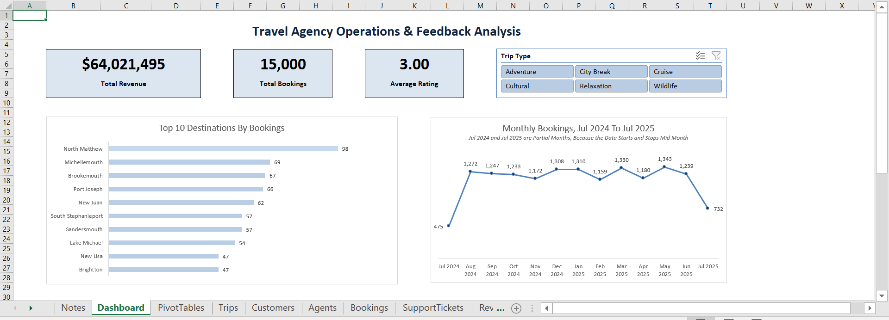
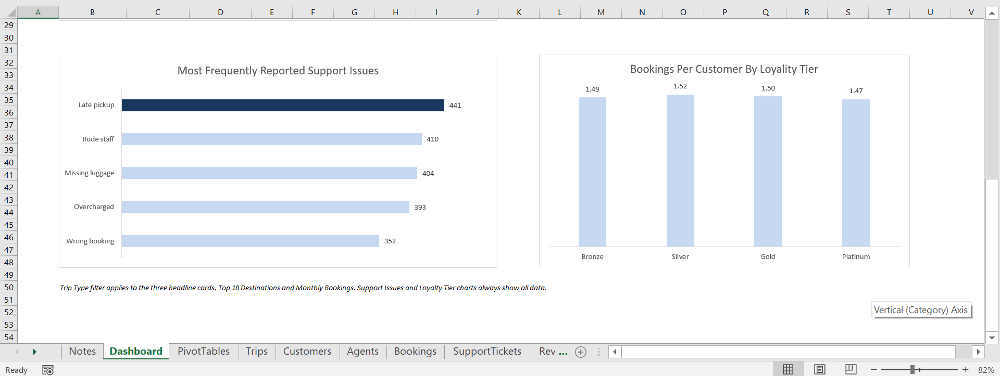

# Travel Agency Operations & Feedback Analysis

An Excel analysis of a travel agency's bookings, customer reviews and support tickets, built with Power Query, the Excel Data Model (Power Pivot) and DAX measures, and presented as an interactive dashboard.

## Business questions

- Which trips are most popular by season, type and region?
- Who earns the most revenue, and how do bookings change month to month?
- How do customers rate trips, and which support issues come up most?
- Do loyalty tiers book more often or rate trips higher?

## Key findings

| Area | Finding |
|---|---|
| Revenue | Total revenue is $64,021,495. The top agent (Timothy Baker, $2,808,986) is within about 3% of the next two, so no agent dominates. |
| Popularity | Spring is the busiest season (4,386 bookings), Winter the quietest (3,096). Wildlife is the most booked trip type (3,057). |
| Destinations | Bookings are spread across about 488 destinations. The leader, North Matthew, has 98 bookings, under 1% of the total. |
| Trend | Monthly bookings stay between about 1,160 and 1,340 from Aug 2024 to Jun 2025 with no clear rise or fall. Jul 2024 and Jul 2025 are partial months, not real drops. |
| Satisfaction | Average review rating is 3.00 and barely varies by trip type (about 2.96 to 3.04). |
| Support | Late pickup is the most reported issue (441 of 2,000 tickets), but all five issues sit between 18% and 22% of tickets. |
| Loyalty | Raw bookings fall from Bronze to Platinum only because the tiers differ in size. Per customer, bookings (1.47 to 1.52) and ratings (2.95 to 3.02) are almost identical, so tier shows no meaningful link to either. |

## Recommendations

1. **Support:** Late pickup and Rude staff make up about 43% of tickets. Review pickup scheduling and staff training first, and analyse resolution rates by issue, since frequency alone says little about severity.
2. **Demand:** Spring and Summer produce about 58% of bookings. Winter promotions or Wildlife-themed offers could balance demand.
3. **Loyalty:** Test whether tier benefits actually encourage repeat bookings, because higher tiers do not book more often today.
4. **Trip quality:** Ratings average 3.0 out of 5 with no standout trip type, so group the comments on 1 and 2 star reviews into themes to find what to fix.

## Method

1. Converted each sheet to a named Excel table and kept an untouched raw backup.
2. Loaded all six tables through Power Query, profiled them on the full data set, and checked IDs, blanks, data types and category values.
3. Loaded them to the Data Model and built five one-to-many relationships: Trips, Customers and Agents to Bookings; Bookings to Reviews; Customers to Support Tickets.
4. Wrote DAX measures once and reused them in every PivotTable and chart.
5. Built the dashboard with KPI cards, four charts and a Trip Type slicer connected only to the pivots it can correctly filter.

### Measures

| Measure | Definition |
|---|---|
| Total Revenue | `SUMX(tblBookings, RELATED(tblTrips[PriceUSD]) * tblBookings[NumTravelers])` |
| Total Bookings | `COUNTROWS(tblBookings)` |
| Average Rating | `AVERAGE(tblReviews[Rating])` (individual reviews, not the Trips AvgRating column, to avoid averaging averages) |
| Total Customers | `COUNTROWS(tblCustomers)` |
| Total Tickets | `COUNTROWS(tblSupportTickets)` |
| Bookings per Customer | `DIVIDE([Total Bookings], [Total Customers])` |

## Limitations

- Region means the agent's home state, not where travellers went, because the Trips table has no region.
- Both ends of the booking period are partial months.
- Revenue is estimated as trip price x travellers. There is no data on discounts, refunds or payments.
- Ratings come from 12,000 reviews against 15,000 bookings, so they reflect only customers who left a review.
- Support tickets link to customers but not to trips, so the Trip Type filter cannot be applied to them.
- The data appears to be a practice dataset, so the flat patterns may not match a real agency's.

## Files

- `Travel_Agency_Analysis.xlsx`: the full workbook (Notes, Dashboard, PivotTables and the source tables)
- `dashboard-1-overview.png`, `dashboard-2-support-loyalty.png`: dashboard screenshots

## Tools

Excel, Power Query, Power Pivot (Data Model), DAX, PivotTables and PivotCharts, slicers.

## Source

This is a guided project from Stephen | Data https://www.youtube.com/watch?v=lz_JA_t_DSg, Day 30 of a 30-day Excel challenge. I built the model, measures and dashboard following the project brief and checked my results against the provided solution file. The Notes sheet and this write-up document my own process and findings.

## Author

Ayomide | www.linkedin.com/in/ayomide-kawonise
